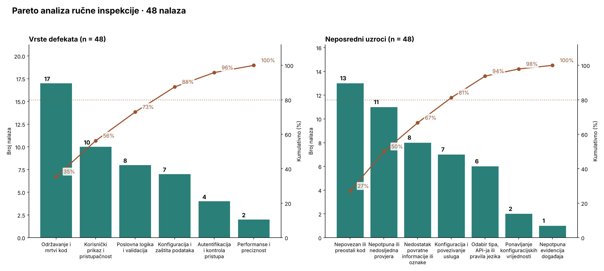

# Izvještaj – Task 1: Inspekcija i statička analiza koda

**Tim:** Grupa 1, Tim 4
**Predmet inspekcije:** kod Tima 3, aplikacija ESportskiCentar
**Evidencija nalaza:** komentari u [PR #1](https://github.com/VVS-2026-2027/Grupa1-Tim4/pull/1) i [Issue kartice](https://github.com/VVS-2026-2027/Grupa1-Tim4/issues)

## 1.1. Inspekcija koda

**Uloge.** Moderator i zapisničar je Dino Tahirović. Inspektori su:
- **Dino Tahirović:** autentifikacija, konfiguracija i infrastruktura;
- **Amir Džafić:** rezervacije, popusti, korisnici i notifikacije;
- **Imran Čustović:** termini, tereni, izvještaji i zajednički layout.

**Način rada.** Korištene su dvije liste provjere:
- **CL-K:** kvalitet koda (Wiegers, Predavanje 2);
- **CL-S:** sigurnost (Predavanje 3, OWASP Top 10 2025 i CWE).

Svaki nalaz je ostavljen kao komentar na liniju koda u PR-u, s ozbiljnošću (skala 1–5, Predavanje 2) i stavkom liste provjere. Za nalaze ozbiljnosti 3–5 otvorene su i Issue kartice. Moderator je pregledao sve komentare, spojio duplikate i izdvojio nalaze koji se nisu potvrdili. Od 69 komentara dobijeno je **48 potvrđenih nalaza**.

### Nalazi po ozbiljnosti

| Ozbiljnost | Broj nalaza |
|---|---:|
| 5 – Kritično | 2 |
| 4 – Visoko | 1 |
| 3 – Srednje | 10 |
| 2 – Nisko | 24 |
| 1 – Minorno | 11 |
| **Ukupno** | **48** |

Po listama provjere: 35 nalaza iz CL-K i 13 iz CL-S.

**Najvažniji nalazi:**
- **Tajne u repozitoriju:** lozinka produkcijske baze i Gmail app lozinka su upisane u `appsettings.json` (ozbiljnost 5, CL-S2.1). [#22](https://github.com/VVS-2026-2027/Grupa1-Tim4/issues/22), [#23](https://github.com/VVS-2026-2027/Grupa1-Tim4/issues/23)
- **Prijava bez zaključavanja naloga:** `lockoutOnFailure: false` omogućava neograničeno pogađanje lozinke (ozbiljnost 4, CL-S7.1). [#25](https://github.com/VVS-2026-2027/Grupa1-Tim4/issues/25)
- **Greške u poslovnoj logici termina:** izmjena termina može napraviti duplikat, a filter odbija današnji datum (ozbiljnost 3). [#31](https://github.com/VVS-2026-2027/Grupa1-Tim4/issues/31), [#32](https://github.com/VVS-2026-2027/Grupa1-Tim4/issues/32)
- **Mailovi se ne šalju:** `EmailService` čita konfiguraciju koja ne postoji (ozbiljnost 3). [#29](https://github.com/VVS-2026-2027/Grupa1-Tim4/issues/29)

**Izdvojeni komentari.** Od 69 komentara, 9 je spojeno s drugim komentarima jer opisuju isti defekt na više mjesta, a 12 nije ušlo u analizu. Razlozi su tri:
- **Latentni propusti:** greška postoji u kodu, ali se trenutno ne može iskoristiti. Na primjer, propusti u `NotifikacijaController` su latentni, jer kontroler ima atribut `[NonController]` i nije dostupan kao ruta.
- **Netačni nalazi:** na primjer, tvrdnja da forma za brisanje rezervacije šalje GET nije tačna, jer Form Tag Helper generiše POST.
- **Nepotvrđeni nalazi:** zavise od poslovnih pravila koja nisu poznata, npr. smije li se mijenjati termin koji je već prošao.

### Pareto analiza defekata

| Vrsta defekta | Broj | Udio | Kumulativno |
|---|---:|---:|---:|
| Održavanje i mrtvi kod | 17 | 35,4% | 35,4% |
| Korisnički prikaz i pristupačnost | 10 | 20,8% | 56,3% |
| Poslovna logika i validacija | 8 | 16,7% | 72,9% |
| Konfiguracija i zaštita podataka | 7 | 14,6% | 87,5% |
| Autentifikacija i kontrola pristupa | 4 | 8,3% | 95,8% |
| Performanse i preciznost | 2 | 4,2% | 100,0% |

Prve tri vrste čine oko 73% nalaza. Najozbiljniji nalazi su ipak u rjeđim kategorijama (konfiguracija i autentifikacija), pa njih treba ispraviti prve.

### Pareto analiza uzroka

| Uzrok | Broj | Udio | Kumulativno |
|---|---:|---:|---:|
| Nepovezan ili preostali kod | 13 | 27,1% | 27,1% |
| Nepotpuna ili nedosljedna provjera | 11 | 22,9% | 50,0% |
| Nedostatak povratne informacije korisniku | 8 | 16,7% | 66,7% |
| Konfiguracija i povezivanje usluga | 7 | 14,6% | 81,3% |
| Odabir tipa, API-ja ili pravila jezika | 6 | 12,5% | 93,8% |
| Ponavljanje konfiguracijskih vrijednosti | 2 | 4,2% | 97,9% |
| Nepotpuna evidencija događaja | 1 | 2,1% | 100,0% |

Četiri uzroka čine oko 80% nalaza. Najčešći su:
- ostaci generisanog koda i nekorišteni prikazi i paketi;
- nepotpune ili nedosljedne provjere ulaza i poslovnih pravila.



## 1.2. Statička analiza koda

**Alat i postavke.** Korišteni su Roslyn (.NET) analizatori iz Predavanja 2, nad istim kodom, sa profilom `All`:

```powershell
dotnet build ESportskiCentar.csproj -p:EnableNETAnalyzers=true -p:AnalysisMode=All -p:EnforceCodeStyleInBuild=true -p:NuGetAudit=false -m:1 -v:minimal
```

**Rezultat.** Build je uspio s **219 upozorenja i 0 grešaka**. Detalji su u [roslyn-rezultati.txt](roslyn-rezultati.txt).

| Pravilo | Broj | Značenje |
|---|---:|---|
| CA2007 | 75 | ConfigureAwait u asinhronim pozivima |
| CS8602 | 31 | Moguć pristup null referenci |
| CA5395 | 30 | Akcija nema eksplicitan atribut HTTP metode |
| CA1515 | 28 | Preporuka o vidljivosti tipova |
| CA1062 | 7 | Nedostaje provjera argumenata javnih metoda |
| CS8618 | 5 | Neinicijalizirana svojstva koja ne smiju biti null |
| Ostala pravila | 43 | Detalji u logu |

**Poređenje s ručnom inspekcijom.**
- **Alat je potvrdio dio ručnih nalaza:** `catch` bez tipa u `VrijemeHelper.cs` (CA1031) i neinicijalizirana svojstva modela (CS8618).
- **Alat je našao i nešto što ručni pregled nije:** neoslobođen `HttpRequestMessage` u `EmailService.cs` (CA2000).
- **Alat nije našao nijedan od najozbiljnijih ručnih nalaza:** tajne u konfiguraciji, isključen lockout, greške u poslovnoj logici termina. Za njih je potrebno razumijevanje konfiguracije i poslovnih pravila.

**Lažno pozitivni rezultati (Predavanje 2, slajd 23).**
- **CA2007** nema efekta u ASP.NET Core aplikaciji, jer ona nema SynchronizationContext.
- **CA1515** predlaže da tipovi ne budu javni, a to se ne smije primijeniti na MVC kontrolere.

Ova dva pravila čine 47% svih upozorenja, pa profil `All` bez podešavanja daje mnogo šuma.
